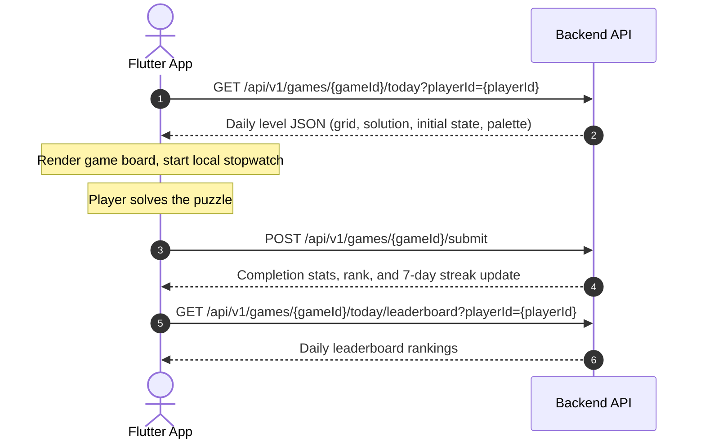

# Flutter Integration Guide: Sudoku & Patch Puzzle Games

This guide provides end-to-end instructions, data models, state management patterns, and production-ready Flutter code for integrating **Sudoku (6×6 and 9×9)** and **Patch Game (Polyomino Board Partitioning)** into your mobile application.

---

## 1. Architecture & API Flow

Both games follow the exact same daily puzzle flow:



* **Base URL**: `https://api.pravasamedia.com/api/v1` (or local `http://localhost:1100/api/v1`)
* **Sudoku Endpoint**: `/games/sudoku/today`
* **Patch Endpoint**: `/games/patch/today`
* **Submit Endpoint**: `/games/{gameId}/submit`

---

## 2. API Service Layer (`puzzle_api_service.dart`)

```dart
import 'dart:convert';
import 'package:http/http.dart' as http;

class PuzzleApiService {
  static const String baseUrl = 'https://api.pravasamedia.com/api/v1';

  /// 1. Fetch today's official daily puzzle
  static Future<Map<String, dynamic>> getTodayGame({
    required String gameSlug, // 'sudoku' or 'patch'
    String? playerId,
  }) async {
    final query = playerId != null ? '?playerId=$playerId' : '';
    final response = await http.get(Uri.parse('$baseUrl/games/$gameSlug/today$query'));

    if (response.statusCode == 200) {
      final json = jsonDecode(response.body);
      return json['data'];
    }
    throw Exception('Failed to load $gameSlug: ${response.body}');
  }

  /// 2. Submit puzzle completion & save streak
  static Future<Map<String, dynamic>> submitGame({
    required String gameSlug,
    required String playerId,
    required int durationMs,
    required int score,
    String? displayName,
    int? moves,
  }) async {
    final response = await http.post(
      Uri.parse('$baseUrl/games/$gameSlug/submit'),
      headers: {'Content-Type': 'application/json'},
      body: jsonEncode({
        'playerId': playerId,
        'durationMs': durationMs,
        'score': score,
        'displayName': displayName ?? 'Player',
        'completed': true,
        'moves': moves,
      }),
    );

    if (response.statusCode == 200 || response.statusCode == 201) {
      final json = jsonDecode(response.body);
      return json['data'];
    }
    throw Exception('Failed to submit score: ${response.body}');
  }

  /// 3. Fetch today's leaderboard
  static Future<Map<String, dynamic>> getLeaderboard({
    required String gameSlug,
    required String playerId,
  }) async {
    final response = await http.get(
      Uri.parse('$baseUrl/games/$gameSlug/today/leaderboard?playerId=$playerId'),
    );

    if (response.statusCode == 200) {
      return jsonDecode(response.body)['data'];
    }
    throw Exception('Failed to load leaderboard: ${response.body}');
  }
}
```

---

## 3. Sudoku Integration (6×6 & 9×9)

### 3.1 Data Model (`sudoku_model.dart`)

```dart
import 'package:flutter/material.dart';

class SudokuLevel {
  final String levelId;
  final int levelNumber;
  final String difficulty;
  final int rows;
  final int columns;
  final int boxRows;
  final int boxCols;
  final List<List<int>> initialGrid;
  final List<List<int>> solution;
  final SudokuPalette palette;

  SudokuLevel({
    required this.levelId,
    required this.levelNumber,
    required this.difficulty,
    required this.rows,
    required this.columns,
    required this.boxRows,
    required this.boxCols,
    required this.initialGrid,
    required this.solution,
    required this.palette,
  });

  factory SudokuLevel.fromJson(Map<String, dynamic> json) {
    final content = json['content'];
    final grid = content['grid'];
    final rows = grid['rows'] as int;
    final columns = grid['columns'] as int;

    // 6x6 uses 2x3 blocks, 9x9 uses 3x3 blocks, 4x4 uses 2x2 blocks
    final boxRows = rows == 6 ? 2 : (rows == 4 ? 2 : 3);
    final boxCols = rows == 6 ? 3 : (rows == 4 ? 2 : 3);

    return SudokuLevel(
      levelId: json['levelId'],
      levelNumber: json['levelNumber'],
      difficulty: json['difficulty'],
      rows: rows,
      columns: columns,
      boxRows: boxRows,
      boxCols: boxCols,
      initialGrid: (content['initialGrid'] as List)
          .map((row) => (row as List).map((c) => c as int).toList())
          .toList(),
      solution: (content['solution'] as List)
          .map((row) => (row as List).map((c) => c as int).toList())
          .toList(),
      palette: SudokuPalette.fromJson(content['palette'] ?? {}),
    );
  }
}

class SudokuPalette {
  final Color gridBorder;
  final Color blockBorder;
  final Color cellBackground;
  final Color selectedCell;
  final Color highlightNumber;
  final Color clueText;
  final Color userText;

  SudokuPalette({
    required this.gridBorder,
    required this.blockBorder,
    required this.cellBackground,
    required this.selectedCell,
    required this.highlightNumber,
    required this.clueText,
    required this.userText,
  });

  factory SudokuPalette.fromJson(Map<String, dynamic> json) {
    Color parseHex(String? hex, Color fallback) {
      if (hex == null || !hex.startsWith('#')) return fallback;
      return Color(int.parse(hex.replaceFirst('#', '0xFF')));
    }

    return SudokuPalette(
      gridBorder: parseHex(json['gridBorder'], const Color(0xFFBDC3C7)),
      blockBorder: parseHex(json['blockBorder'], const Color(0xFF1A252F)),
      cellBackground: parseHex(json['cellBackground'], Colors.white),
      selectedCell: parseHex(json['selectedCell'], const Color(0xFFD6EAF8)),
      highlightNumber: parseHex(json['highlightNumber'], const Color(0xFFAED6F1)),
      clueText: parseHex(json['clueText'], const Color(0xFF1B2631)),
      userText: parseHex(json['userText'], const Color(0xFF2980B9)),
    );
  }
}
```

---

### 3.2 Sudoku UI Screen (`sudoku_game_screen.dart`)

```dart
import 'dart:async';
import 'package:flutter/material.dart';
import 'sudoku_model.dart';
import 'puzzle_api_service.dart';

class SudokuGameScreen extends StatefulWidget {
  final String playerId;
  const SudokuGameScreen({Key? key, required this.playerId}) : super(key: key);

  @override
  State<SudokuGameScreen> createState() => _SudokuGameScreenState();
}

class _SudokuGameScreenState extends State<SudokuGameScreen> {
  SudokuLevel? _level;
  late List<List<int>> _userGrid;
  int? _selectedRow;
  int? _selectedCol;
  bool _isLoading = true;
  bool _isCompleted = false;

  final Stopwatch _stopwatch = Stopwatch();
  Timer? _timer;

  @override
  void initState() {
    super.initState();
    _loadDailySudoku();
  }

  @override
  void dispose() {
    _timer?.cancel();
    super.dispose();
  }

  Future<void> _loadDailySudoku() async {
    try {
      final data = await PuzzleApiService.getTodayGame(
        gameSlug: 'sudoku',
        playerId: widget.playerId,
      );
      final level = SudokuLevel.fromJson(data);
      setState(() {
        _level = level;
        // Deep copy initialGrid to userGrid
        _userGrid = level.initialGrid.map((row) => List<int>.from(row)).toList();
        _isLoading = false;
      });
      _stopwatch.start();
      _timer = Timer.periodic(const Duration(seconds: 1), (_) => setState(() {}));
    } catch (e) {
      ScaffoldMessenger.of(context).showSnackBar(SnackBar(content: Text('Error: $e')));
    }
  }

  void _onCellTapped(int row, int col) {
    if (_level == null || _level!.initialGrid[row][col] != 0) {
      // Cannot edit initial clue numbers
      setState(() {
        _selectedRow = row;
        _selectedCol = col;
      });
      return;
    }
    setState(() {
      _selectedRow = row;
      _selectedCol = col;
    });
  }

  void _onNumberPressed(int number) {
    if (_selectedRow == null || _selectedCol == null || _level == null) return;
    final r = _selectedRow!;
    final c = _selectedCol!;

    // Cannot overwrite initial clue
    if (_level!.initialGrid[r][c] != 0) return;

    setState(() {
      _userGrid[r][c] = number;
    });

    _checkCompletion();
  }

  void _onErasePressed() {
    if (_selectedRow == null || _selectedCol == null || _level == null) return;
    final r = _selectedRow!;
    final c = _selectedCol!;
    if (_level!.initialGrid[r][c] == 0) {
      setState(() {
        _userGrid[r][c] = 0;
      });
    }
  }

  void _checkCompletion() {
    if (_level == null) return;
    for (int r = 0; r < _level!.rows; r++) {
      for (int c = 0; c < _level!.columns; c++) {
        if (_userGrid[r][c] == 0 || _userGrid[r][c] != _level!.solution[r][c]) {
          return; // Still empty or wrong
        }
      }
    }

    // Success!
    _stopwatch.stop();
    setState(() => _isCompleted = true);
    _submitScore();
  }

  Future<void> _submitScore() async {
    final duration = _stopwatch.elapsedMilliseconds;
    final res = await PuzzleApiService.submitGame(
      gameSlug: 'sudoku',
      playerId: widget.playerId,
      durationMs: duration,
      score: 100,
    );

    showDialog(
      context: context,
      barrierDismissible: false,
      builder: (_) => AlertDialog(
        title: const Text('🎉 Sudoku Solved!'),
        content: Text(
          'Time: ${(duration / 1000).toStringAsFixed(1)}s\n'
          'Rank: #${res['rank']}\n'
          'Streak: ${res['streak']['currentStreak']} days!',
        ),
        actions: [
          TextButton(
            onPressed: () => Navigator.pop(context),
            child: const Text('View Leaderboard'),
          ),
        ],
      ),
    );
  }

  @override
  Widget build(BuildContext context) {
    if (_isLoading) {
      return const Scaffold(body: Center(child: CircularProgressIndicator()));
    }

    final level = _level!;
    final palette = level.palette;
    final elapsedSec = _stopwatch.elapsed.inSeconds;

    return Scaffold(
      appBar: AppBar(
        title: Text('Sudoku (${level.rows}x${level.columns})'),
        actions: [
          Padding(
            padding: const EdgeInsets.only(right: 16),
            child: Center(
              child: Text(
                '${(elapsedSec ~/ 60).toString().padLeft(2, '0')}:${(elapsedSec % 60).toString().padLeft(2, '0')}',
                style: const TextStyle(fontSize: 18, fontWeight: FontWeight.bold),
              ),
            ),
          )
        ],
      ),
      body: Column(
        children: [
          const SizedBox(height: 12),
          // --- SUDOKU GRID ---
          Padding(
            padding: const EdgeInsets.all(16.0),
            child: AspectRatio(
              aspectRatio: 1,
              child: Container(
                decoration: BoxDecoration(
                  border: Border.all(color: palette.blockBorder, width: 2.5),
                ),
                child: Column(
                  children: List.generate(level.rows, (r) {
                    return Expanded(
                      child: Row(
                        children: List.generate(level.columns, (c) {
                          final isClue = level.initialGrid[r][c] != 0;
                          final value = _userGrid[r][c];
                          final isSelected = _selectedRow == r && _selectedCol == c;

                          // Dynamic block border detection
                          final isBottomBlockBorder = (r + 1) % level.boxRows == 0 && r != level.rows - 1;
                          final isRightBlockBorder = (c + 1) % level.boxCols == 0 && c != level.columns - 1;

                          return Expanded(
                            child: GestureDetector(
                              onTap: () => _onCellTapped(r, c),
                              child: Container(
                                decoration: BoxDecoration(
                                  color: isSelected
                                      ? palette.selectedCell
                                      : palette.cellBackground,
                                  border: Border(
                                    bottom: BorderSide(
                                      color: isBottomBlockBorder
                                          ? palette.blockBorder
                                          : palette.gridBorder,
                                      width: isBottomBlockBorder ? 2.0 : 0.8,
                                    ),
                                    right: BorderSide(
                                      color: isRightBlockBorder
                                          ? palette.blockBorder
                                          : palette.gridBorder,
                                      width: isRightBlockBorder ? 2.0 : 0.8,
                                    ),
                                  ),
                                ),
                                child: Center(
                                  child: Text(
                                    value == 0 ? '' : '$value',
                                    style: TextStyle(
                                      fontSize: level.rows == 6 ? 26 : 20,
                                      fontWeight: isClue ? FontWeight.w900 : FontWeight.w600,
                                      color: isClue ? palette.clueText : palette.userText,
                                    ),
                                  ),
                                ),
                              ),
                            ),
                          );
                        }),
                      ),
                    );
                  }),
                ),
              ),
            ),
          ),
          const Spacer(),
          // --- NUMBER KEYPAD ---
          Padding(
            padding: const EdgeInsets.symmetric(horizontal: 16.0, vertical: 24.0),
            child: Row(
              mainAxisAlignment: MainAxisAlignment.spaceEvenly,
              children: [
                ...List.generate(level.rows, (index) {
                  final num = index + 1;
                  return SizedBox(
                    width: level.rows == 6 ? 48 : 36,
                    height: 52,
                    child: ElevatedButton(
                      style: ElevatedButton.styleFrom(padding: EdgeInsets.zero),
                      onPressed: () => _onNumberPressed(num),
                      child: Text('$num', style: const TextStyle(fontSize: 20)),
                    ),
                  );
                }),
                IconButton(
                  icon: const Icon(Icons.backspace_outlined),
                  onPressed: _onErasePressed,
                ),
              ],
            ),
          ),
        ],
      ),
    );
  }
}
```

---

## 4. Patch Game Integration (Polyomino Board Fitting)

In **Patch**, players fit multi-cell polyomino patches onto a grid ($5 \times 5$, $6 \times 6$, etc.) until the board is completely covered.

### 4.1 Data Model (`patch_model.dart`)

```dart
import 'package:flutter/material.dart';

class PatchLevel {
  final String levelId;
  final int levelNumber;
  final String difficulty;
  final int rows;
  final int columns;
  final List<PatchPiece> pieces;
  final Color gridBorder;
  final Color boardBackground;

  PatchLevel({
    required this.levelId,
    required this.levelNumber,
    required this.difficulty,
    required this.rows,
    required this.columns,
    required this.pieces,
    required this.gridBorder,
    required this.boardBackground,
  });

  factory PatchLevel.fromJson(Map<String, dynamic> json) {
    final content = json['content'];
    final grid = content['grid'];
    final palette = content['palette'] ?? {};

    Color parseHex(String? hex, Color fallback) {
      if (hex == null || !hex.startsWith('#')) return fallback;
      return Color(int.parse(hex.replaceFirst('#', '0xFF')));
    }

    return PatchLevel(
      levelId: json['levelId'],
      levelNumber: json['levelNumber'],
      difficulty: json['difficulty'],
      rows: grid['rows'],
      columns: grid['columns'],
      pieces: (content['pieces'] as List)
          .map((p) => PatchPiece.fromJson(p))
          .toList(),
      gridBorder: parseHex(palette['gridBorder'], const Color(0xFFBDC3C7)),
      boardBackground: parseHex(palette['boardBackground'], const Color(0xFFF4F6F7)),
    );
  }
}

class PatchPiece {
  final String id;
  final Color color;
  final List<PatchCoord> cells;

  PatchPiece({required this.id, required this.color, required this.cells});

  factory PatchPiece.fromJson(Map<String, dynamic> json) {
    Color parseHex(String hex) {
      return Color(int.parse(hex.replaceFirst('#', '0xFF')));
    }

    return PatchPiece(
      id: json['id'],
      color: parseHex(json['color'] ?? '#3498DB'),
      cells: (json['cells'] as List)
          .map((c) => PatchCoord(row: c['row'], col: c['col']))
          .toList(),
    );
  }
}

class PatchCoord {
  final int row;
  final int col;
  PatchCoord({required this.row, required this.col});
}
```

---

### 4.2 Patch Game UI & Placement (`patch_game_screen.dart`)

```dart
import 'package:flutter/material.dart';
import 'patch_model.dart';
import 'puzzle_api_service.dart';

class PatchGameScreen extends StatefulWidget {
  final String playerId;
  const PatchGameScreen({Key? key, required this.playerId}) : super(key: key);

  @override
  State<PatchGameScreen> createState() => _PatchGameScreenState();
}

class _PatchGameScreenState extends State<PatchGameScreen> {
  PatchLevel? _level;
  late List<List<String?>> _board; // Holds pieceId for placed cells
  PatchPiece? _selectedPiece;
  final Set<String> _placedPieceIds = {};
  bool _isLoading = true;

  @override
  void initState() {
    super.initState();
    _loadDailyPatch();
  }

  Future<void> _loadDailyPatch() async {
    final data = await PuzzleApiService.getTodayGame(
      gameSlug: 'patch',
      playerId: widget.playerId,
    );
    final level = PatchLevel.fromJson(data);
    setState(() {
      _level = level;
      _board = List.generate(level.rows, (_) => List.filled(level.columns, null));
      _isLoading = false;
    });
  }

  /// Check if piece can be placed with anchor at (anchorRow, anchorCol)
  bool _canPlacePiece(PatchPiece piece, int anchorRow, int anchorCol) {
    final level = _level!;
    for (final cell in piece.cells) {
      final r = anchorRow + cell.row;
      final c = anchorCol + cell.col;

      // 1. Grid boundary check
      if (r < 0 || r >= level.rows || c < 0 || c >= level.columns) {
        return false;
      }
      // 2. Overlap check
      if (_board[r][c] != null) {
        return false;
      }
    }
    return true;
  }

  void _onBoardCellTapped(int row, int col) {
    if (_selectedPiece == null) {
      // Tap on placed piece to remove it
      final placedId = _board[row][col];
      if (placedId != null) {
        _removePlacedPiece(placedId);
      }
      return;
    }

    final piece = _selectedPiece!;
    if (_canPlacePiece(piece, row, col)) {
      setState(() {
        for (final cell in piece.cells) {
          _board[row + cell.row][col + cell.col] = piece.id;
        }
        _placedPieceIds.add(piece.id);
        _selectedPiece = null;
      });
      _checkWinCondition();
    } else {
      ScaffoldMessenger.of(context).showSnackBar(
        const SnackBar(content: Text('Cannot place piece here (overlap or out of bounds)')),
      );
    }
  }

  void _removePlacedPiece(String pieceId) {
    setState(() {
      for (int r = 0; r < _level!.rows; r++) {
        for (int c = 0; c < _level!.columns; c++) {
          if (_board[r][c] == pieceId) {
            _board[r][c] = null;
          }
        }
      }
      _placedPieceIds.remove(pieceId);
    });
  }

  void _checkWinCondition() {
    final level = _level!;
    for (int r = 0; r < level.rows; r++) {
      for (int c = 0; c < level.columns; c++) {
        if (_board[r][c] == null) return; // Still empty cells
      }
    }

    // Complete board covered!
    PuzzleApiService.submitGame(
      gameSlug: 'patch',
      playerId: widget.playerId,
      durationMs: 32000,
      score: 100,
    );

    showDialog(
      context: context,
      builder: (_) => AlertDialog(
        title: const Text('🎉 Patch Solved!'),
        content: const Text('All patches placed perfectly!'),
        actions: [
          TextButton(onPressed: () => Navigator.pop(context), child: const Text('OK'))
        ],
      ),
    );
  }

  @override
  Widget build(BuildContext context) {
    if (_isLoading) {
      return const Scaffold(body: Center(child: CircularProgressIndicator()));
    }

    final level = _level!;
    final remainingPieces = level.pieces.where((p) => !_placedPieceIds.contains(p.id)).toList();

    return Scaffold(
      appBar: AppBar(title: Text('Patch (${level.rows}x${level.columns})')),
      body: Column(
        children: [
          const SizedBox(height: 16),
          // --- PATCH BOARD ---
          Padding(
            padding: const EdgeInsets.all(16.0),
            child: AspectRatio(
              aspectRatio: 1,
              child: Container(
                color: level.boardBackground,
                child: Column(
                  children: List.generate(level.rows, (r) {
                    return Expanded(
                      child: Row(
                        children: List.generate(level.columns, (c) {
                          final pieceId = _board[r][c];
                          final piece = pieceId != null
                              ? level.pieces.firstWhere((p) => p.id == pieceId)
                              : null;

                          return Expanded(
                            child: GestureDetector(
                              onTap: () => _onBoardCellTapped(r, c),
                              child: Container(
                                margin: const EdgeInsets.all(1.5),
                                decoration: BoxDecoration(
                                  color: piece?.color ?? Colors.white,
                                  border: Border.all(color: level.gridBorder, width: 0.8),
                                  borderRadius: BorderRadius.circular(4),
                                ),
                              ),
                            ),
                          );
                        }),
                      ),
                    );
                  }),
                ),
              ),
            ),
          ),
          const SizedBox(height: 12),
          const Text('Select a patch and tap board to place:'),
          const SizedBox(height: 8),
          // --- PATCH PIECE TRAY ---
          Expanded(
            child: ListView.builder(
              scrollDirection: Axis.horizontal,
              padding: const EdgeInsets.symmetric(horizontal: 16),
              itemCount: remainingPieces.length,
              itemBuilder: (context, index) {
                final piece = remainingPieces[index];
                final isSelected = _selectedPiece?.id == piece.id;

                return GestureDetector(
                  onTap: () => setState(() => _selectedPiece = isSelected ? null : piece),
                  child: Container(
                    margin: const EdgeInsets.all(8),
                    padding: const EdgeInsets.all(8),
                    decoration: BoxDecoration(
                      border: Border.all(
                        color: isSelected ? Colors.black : Colors.grey.shade300,
                        width: isSelected ? 2.5 : 1.0,
                      ),
                      borderRadius: BorderRadius.circular(8),
                    ),
                    child: _buildMiniPiecePreview(piece),
                  ),
                );
              },
            ),
          ),
        ],
      ),
    );
  }

  Widget _buildMiniPiecePreview(PatchPiece piece) {
    int maxR = 0;
    int maxC = 0;
    for (final c in piece.cells) {
      if (c.row > maxR) maxR = c.row;
      if (c.col > maxC) maxC = c.col;
    }

    return Column(
      mainAxisSize: MainAxisSize.min,
      children: List.generate(maxR + 1, (r) {
        return Row(
          mainAxisSize: MainAxisSize.min,
          children: List.generate(maxC + 1, (c) {
            final hasCell = piece.cells.any((cell) => cell.row == r && cell.col == c);
            return Container(
              width: 16,
              height: 16,
              margin: const EdgeInsets.all(1),
              decoration: BoxDecoration(
                color: hasCell ? piece.color : Colors.transparent,
                borderRadius: BorderRadius.circular(2),
              ),
            );
          }),
        );
      }),
    );
  }
}
```

---

## 5. Summary Table: Game Integration Checklist

| Feature | Sudoku | Patch |
|---|---|---|
| **API Endpoint** | `GET /games/sudoku/today` | `GET /games/patch/today` |
| **Grid Dimensions** | 6×6 (Mini) & 9×9 (Standard) | 5×5, 6×6, etc. |
| **User Input** | Tapping cell + numeric keypad (1..N) | Selecting patch piece + tapping anchor cell |
| **Immutable Elements** | `initialGrid[r][c] != 0` clues cannot be modified | Placed pieces can be removed by tapping |
| **Win Condition** | User grid matches `solution` exactly | All board cells filled with non-overlapping pieces |
| **Score Submission** | `POST /games/sudoku/submit` | `POST /games/patch/submit` |
