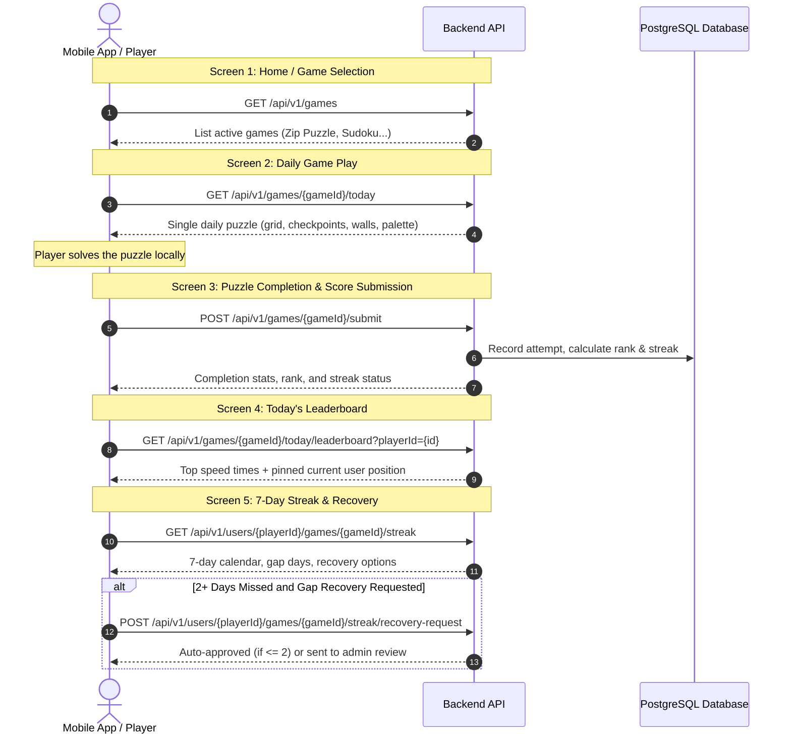

# Puzzle Games – User-Side API Integration Guide

This guide documents the complete integration flow for the **Daily Puzzle Games** system (supporting **Zip Puzzle**, **Sudoku**, etc.) for mobile (Flutter / React Native) and web applications.

---

## 1. Overview & Architecture

* **Base URL**: `http://<API_HOST>:1100/api/v1` (or your production API base URL)
* **Design Philosophy**:
  * **Daily Puzzle Format**: Similar to *Wordle* or *NYT Games*, there is **no 100-level grid catalogue** for players. Each game publishes **one official puzzle per day**.
  * **Timezone-Aware**: Daily puzzle rollover and activity tracking default to `Asia/Kolkata` (configurable per game).
  * **7-Day Streak Calendar**: Tracks player consistency across the rolling 7-day window.
  * **Monthly Free Revive (1 Miss / Month)**: If a user misses exactly 1 day within a calendar month, their streak is automatically saved and revived on their next game completion.
  * **Gap Recovery Request (2+ Missed Days)**: If a player misses 2 or more days, they can submit a streak retrieval request. The system **automatically approves the first 2 requests**. Further requests are forwarded to admin review.

---

## 2. Player Journey Flowchart



---

## 3. Endpoints Specification

### 3.1 List Active Games
Fetch all available games to render on the games selection screen.

* **Method**: `GET`
* **URL**: `/api/v1/games`
* **Headers**: `Accept: application/json`

#### Response (`200 OK`)
```json
{
  "success": true,
  "data": {
    "items": [
      {
        "id": "16ff42eb-f4b6-4ddf-a5bc-69cb91ce0a44",
        "slug": "zip_puzzle",
        "name": "Zip Puzzle",
        "gameType": "zip",
        "timezone": "Asia/Kolkata",
        "description": "Trace paths connecting numbered checkpoints sequentially without crossing walls or repeating cells.",
        "iconUrl": "https://cdn.example.com/icons/zip.png",
        "isActive": true
      }
    ],
    "meta": {
      "total": 1,
      "page": 1,
      "limit": 50,
      "totalPages": 1
    }
  }
}
```

---

### 3.2 Get Today's Single Daily Puzzle
Fetches the complete playable content for today's puzzle. The app renders the grid, walls, and checkpoints immediately.

* **Method**: `GET`
* **URL**: `/api/v1/games/{gameId}/today` *(alias: `/api/v1/games/{gameId}/daily`)*
* **Path Parameters**:
  * `gameId` *(string, required)*: The slug identifier of the game (e.g. `zip_puzzle`).
* **Query Parameters**:
  * `date` *(string, optional)*: Date in `YYYY-MM-DD` format. Defaults to today's date in the game's business timezone.

#### Response (`200 OK`)
```json
{
  "success": true,
  "data": {
    "gameId": "zip_puzzle",
    "gameName": "Zip Puzzle",
    "gameType": "zip",
    "puzzleDate": "2026-10-22",
    "timezone": "Asia/Kolkata",
    "levelId": "zip_001",
    "levelNumber": 1,
    "title": "First Steps",
    "difficulty": "easy",
    "schemaVersion": 1,
    "contentVersion": 1,
    "content": {
      "grid": {
        "rows": 4,
        "columns": 4
      },
      "palette": {
        "cell": "#EAF0FF",
        "path": "#5D7CF6",
        "warning": "#E5484D",
        "checkpoint": "#FFFFFF"
      },
      "checkpoints": [
        { "col": 0, "row": 0, "number": 1 },
        { "col": 3, "row": 0, "number": 2 },
        { "col": 3, "row": 3, "number": 3 },
        { "col": 0, "row": 3, "number": 4 }
      ],
      "walls": [
        {
          "from": { "col": 1, "row": 0 },
          "to": { "col": 1, "row": 1 }
        }
      ],
      "solutionPath": [
        { "col": 0, "row": 0 },
        { "col": 1, "row": 0 },
        { "col": 2, "row": 0 },
        { "col": 3, "row": 0 },
        { "col": 3, "row": 1 },
        { "col": 2, "row": 1 },
        { "col": 1, "row": 1 },
        { "col": 0, "row": 1 },
        { "col": 0, "row": 2 },
        { "col": 1, "row": 2 },
        { "col": 2, "row": 2 },
        { "col": 3, "row": 2 },
        { "col": 3, "row": 3 },
        { "col": 2, "row": 3 },
        { "col": 1, "row": 3 },
        { "col": 0, "row": 3 }
      ]
    }
  }
}
```

---

### 3.3 Submit Today's Game Completion
Call this endpoint as soon as the user completes today's game.

* **Method**: `POST`
* **URL**: `/api/v1/games/{gameId}/submit` *(alias: `/api/v1/games/{gameId}/today/submit`)*
* **Headers**: `Content-Type: application/json`
* **Request Body**:
```json
{
  "playerId": "user_abc123",
  "durationMs": 28400,
  "score": 100,
  "displayName": "Pravasa",
  "avatarUrl": "https://cdn.example.com/avatars/user.png",
  "completed": true,
  "moves": 16
}
```

| Field | Type | Required | Description |
|---|---|---|---|
| `playerId` | `string` | **Yes** | User's stable ID or unique device ID. |
| `durationMs` | `number` | **Yes** | Time taken to solve in milliseconds (e.g. `28400` = 28.4s). |
| `score` | `number` | No | Score points earned (defaults to `100`). |
| `displayName` | `string` | No | Player's display name for leaderboard. |
| `avatarUrl` | `string` | No | Optional player profile image URL. |
| `completed` | `boolean` | No | Set to `true` on successful completion. |
| `moves` | `number` | No | Optional number of moves taken. |

#### Response (`201 Created` / `200 OK`)
```json
{
  "success": true,
  "data": {
    "gameId": "zip_puzzle",
    "levelId": "zip_001",
    "levelNumber": 1,
    "playerId": "user_abc123",
    "durationMs": 28400,
    "bestDurationMs": 28400,
    "score": 100,
    "isNewBest": true,
    "rank": 1,
    "streak": {
      "currentStreak": 5,
      "longestStreak": 12,
      "streakMaintained": true,
      "freeMonthlyReviveApplied": false
    }
  }
}
```

---

### 3.4 Today's Daily Speed Leaderboard
Displays top players who completed today's puzzle ranked by lowest completion time (`bestDurationMs`). Automatically pins the current player's rank at the top.

* **Method**: `GET`
* **URL**: `/api/v1/games/{gameId}/today/leaderboard`
* **Query Parameters**:
  * `playerId` *(string, recommended)*: Highlights current user rank.
  * `page` *(number, optional)*: Page number (default `1`).
  * `limit` *(number, optional)*: Items per page (default `50`).

#### Response (`200 OK`)
```json
{
  "success": true,
  "data": {
    "gameId": "zip_puzzle",
    "levelId": "zip_001",
    "currentUser": {
      "rank": 1,
      "playerId": "user_abc123",
      "displayName": "Pravasa",
      "avatarUrl": "https://cdn.example.com/avatars/user.png",
      "bestDurationMs": 28400,
      "score": 100,
      "completedAt": "2026-10-22T08:59:49.752Z"
    },
    "entries": [
      {
        "rank": 1,
        "playerId": "user_abc123",
        "displayName": "Pravasa",
        "avatarUrl": "https://cdn.example.com/avatars/user.png",
        "bestDurationMs": 28400,
        "score": 100,
        "completedAt": "2026-10-22T08:59:49.752Z"
      },
      {
        "rank": 2,
        "playerId": "player_alex",
        "displayName": "Alex",
        "avatarUrl": null,
        "bestDurationMs": 29500,
        "score": 100,
        "completedAt": "2026-10-22T08:57:47.874Z"
      }
    ],
    "page": 1,
    "limit": 50,
    "total": 2,
    "totalPages": 1
  }
}
```

---

### 3.5 7-Day Streak Calendar View
Fetches the player's 7-day rolling calendar, streak count, and revive status.

* **Method**: `GET`
* **URL**: `/api/v1/users/{playerId}/games/{gameId}/streak`
* **Path Parameters**:
  * `playerId` *(string, required)*: Player identifier.
  * `gameId` *(string, required)*: Game slug (e.g. `zip_puzzle`).

#### Response (`200 OK`)
```json
{
  "success": true,
  "data": {
    "playerId": "user_abc123",
    "gameId": "zip_puzzle",
    "currentStreak": 5,
    "longestStreak": 12,
    "lastActivityDate": "2026-10-22",
    "monthlyFreeReviveAvailable": true,
    "autoApproveRemaining": 2,
    "gapDays": 0,
    "canRequestRecovery": false,
    "last7Days": [
      { "date": "2026-10-16", "dayName": "Fri", "completed": true,  "isToday": false },
      { "date": "2026-10-17", "dayName": "Sat", "completed": true,  "isToday": false },
      { "date": "2026-10-18", "dayName": "Sun", "completed": true,  "isToday": false },
      { "date": "2026-10-19", "dayName": "Mon", "completed": true,  "isToday": false },
      { "date": "2026-10-20", "dayName": "Tue", "completed": false, "isToday": false },
      { "date": "2026-10-21", "dayName": "Wed", "completed": true,  "isToday": false },
      { "date": "2026-10-22", "dayName": "Thu", "completed": true,  "isToday": true  }
    ]
  }
}
```

#### Meaning of Fields:
* `currentStreak`: Current uninterrupted consecutive days.
* `monthlyFreeReviveAvailable`: If `true`, the user has not yet used their 1 free monthly auto-revive for a 1-day miss.
* `autoApproveRemaining`: Number of auto-approvals remaining for 2+ day gaps (initial quota is `2`).
* `gapDays`: Number of missed days between previous play and today.
* `canRequestRecovery`: `true` if `gapDays >= 2` and a broken streak is eligible for retrieval.

---

### 3.6 Request Streak Recovery (For 2+ Missed Days)
If `canRequestRecovery` is `true`, show a **"Retrieve Streak"** button. Submitting this request restores the broken streak.

* **Method**: `POST`
* **URL**: `/api/v1/users/{playerId}/games/{gameId}/streak/recovery-request`
* **Headers**: `Content-Type: application/json`
* **Request Body**:
```json
{
  "reason": "Was traveling without cellular network"
}
```

#### Response (`200 OK` - Auto-Approved Case)
```json
{
  "success": true,
  "data": {
    "success": true,
    "status": "AUTO_APPROVED",
    "message": "Streak automatically restored! Your streak is now 15 days. Auto-approvals remaining: 1",
    "restoredStreak": 15,
    "autoApproveRemaining": 1,
    "missedDates": ["2026-10-20", "2026-10-21"]
  }
}
```

#### Response (`200 OK` - Pending Admin Review Case)
When `autoApproveRemaining == 0`:
```json
{
  "success": true,
  "data": {
    "success": true,
    "status": "PENDING",
    "message": "Your streak retrieval request has been submitted for admin review.",
    "requestId": "c138d770-b422-446f-8705-cb13ba0d157a"
  }
}
```

---

### 3.7 Get User Games Profile Overview
Useful for user profile screens to show total stats across games.

* **Method**: `GET`
* **URL**: `/api/v1/users/{playerId}/games`

#### Response (`200 OK`)
```json
{
  "success": true,
  "data": {
    "playerId": "user_abc123",
    "items": [
      {
        "gameId": "zip_puzzle",
        "title": "Zip Puzzle",
        "levelsCompleted": 24,
        "bestTimeMs": 28400,
        "totalScore": 2400,
        "currentStreak": 5,
        "longestStreak": 12,
        "lastActivityDate": "2026-10-22",
        "monthlyFreeReviveAvailable": true
      }
    ]
  }
}
```

---

## 4. Flutter Integration Code Example

You can directly copy-paste this Dart client into your Flutter codebase:

```dart
import 'dart:convert';
import 'package:http/http.dart' as http;

class PuzzleGamesApiClient {
  final String baseUrl;
  final http.Client _client = http.Client();

  PuzzleGamesApiClient({this.baseUrl = 'http://localhost:1100/api/v1'});

  /// 1. Get today's single playable puzzle
  Future<Map<String, dynamic>> getTodayGame(String gameId) async {
    final res = await _client.get(Uri.parse('$baseUrl/games/$gameId/today'));
    if (res.statusCode == 200) {
      final json = jsonDecode(res.body);
      return json['data'];
    }
    throw Exception('Failed to load today puzzle: ${res.body}');
  }

  /// 2. Submit puzzle completion (time & score)
  Future<Map<String, dynamic>> submitTodayCompletion({
    required String gameId,
    required String playerId,
    required int durationMs,
    int score = 100,
    String? displayName,
  }) async {
    final res = await _client.post(
      Uri.parse('$baseUrl/games/$gameId/submit'),
      headers: {'Content-Type': 'application/json'},
      body: jsonEncode({
        'playerId': playerId,
        'durationMs': durationMs,
        'score': score,
        'displayName': displayName,
        'completed': true,
      }),
    );
    if (res.statusCode == 200 || res.statusCode == 201) {
      final json = jsonDecode(res.body);
      return json['data'];
    }
    throw Exception('Failed to submit completion: ${res.body}');
  }

  /// 3. Get today's daily leaderboard
  Future<Map<String, dynamic>> getTodayLeaderboard({
    required String gameId,
    required String playerId,
  }) async {
    final uri = Uri.parse('$baseUrl/games/$gameId/today/leaderboard?playerId=$playerId');
    final res = await _client.get(uri);
    if (res.statusCode == 200) {
      final json = jsonDecode(res.body);
      return json['data'];
    }
    throw Exception('Failed to load leaderboard: ${res.body}');
  }

  /// 4. Get 7-day streak calendar & recovery status
  Future<Map<String, dynamic>> getStreak({
    required String gameId,
    required String playerId,
  }) async {
    final res = await _client.get(Uri.parse('$baseUrl/users/$playerId/games/$gameId/streak'));
    if (res.statusCode == 200) {
      final json = jsonDecode(res.body);
      return json['data'];
    }
    throw Exception('Failed to load streak: ${res.body}');
  }

  /// 5. Request streak recovery for 2+ missed days
  Future<Map<String, dynamic>> requestStreakRecovery({
    required String gameId,
    required String playerId,
    String? reason,
  }) async {
    final res = await _client.post(
      Uri.parse('$baseUrl/users/$playerId/games/$gameId/streak/recovery-request'),
      headers: {'Content-Type': 'application/json'},
      body: jsonEncode({'reason': reason ?? 'Missed game gap'}),
    );
    if (res.statusCode == 200 || res.statusCode == 201) {
      final json = jsonDecode(res.body);
      return json['data'];
    }
    throw Exception('Failed to request streak recovery: ${res.body}');
  }
}
```

---

## 5. Summary Table: User APIs Quick Reference

| Action | HTTP Method | Endpoint | Request Body / Query |
|---|---|---|---|
| **List Games** | `GET` | `/games` | None |
| **Get Today's Game** | `GET` | `/games/{gameId}/today` | Optional: `?date=YYYY-MM-DD` |
| **Submit Completion** | `POST` | `/games/{gameId}/submit` | Body: `{ playerId, durationMs, score, displayName }` |
| **Daily Leaderboard** | `GET` | `/games/{gameId}/today/leaderboard` | Query: `?playerId={id}` |
| **7-Day Streak View** | `GET` | `/users/{playerId}/games/{gameId}/streak` | None |
| **Retrieve Streak** | `POST` | `/users/{playerId}/games/{gameId}/streak/recovery-request` | Body: `{ reason }` |
| **User Profile Overview** | `GET` | `/users/{playerId}/games` | None |
